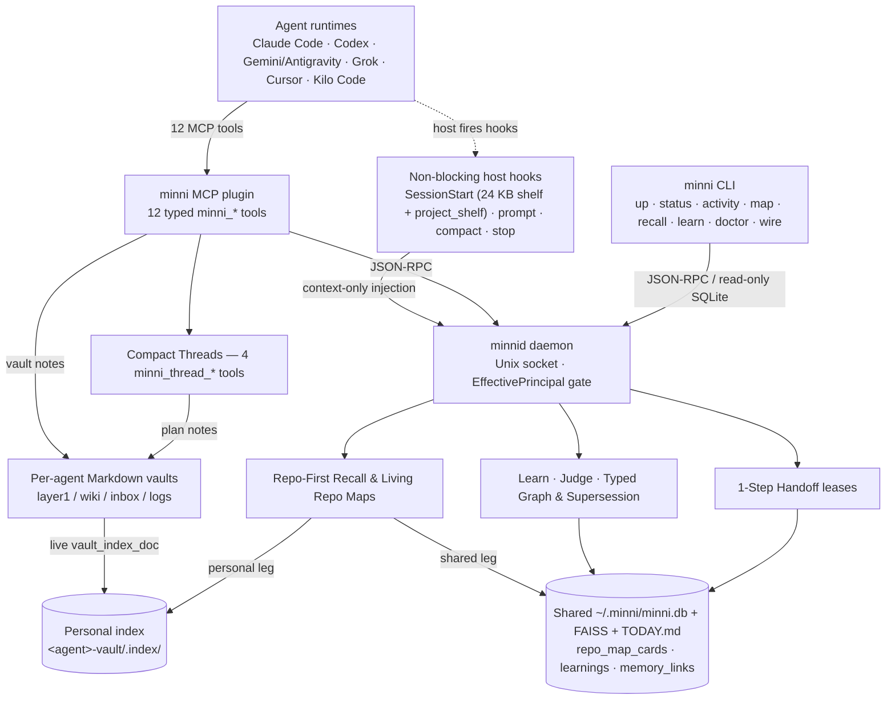

# ᛗ Minni

**Local-first memory and repository orientation for coding agents — one governed daemon, Living Repo Maps, shared across every runtime, with plain-Markdown visibility for the human operator. Recall arrives as cited evidence, never as instruction.**

[](https://github.com/infektyd/minni/actions/workflows/ci.yml)
[](https://pypi.org/project/minni/)


## The problem

Agents lose state. Context evaporates on restart, gets summarized away by compaction, and never crosses from one runtime to the next. Cold agents opening a large codebase burn tokens re-discovering subsystems and repeating yesterday's mistakes, while most memory tools hide extracted facts inside hosted vector APIs or opaque web dashboards you cannot audit.

Minni takes the other bet: keep every memory, subsystem map, and daily digest as plain Markdown on your machine, backed by one governed local daemon across every coding agent you run.

## What Minni is

A single local **daemon** (`minnid`) over a Unix socket, a **12-tool MCP surface** plus a stdlib-only **`minni` CLI**, per-agent **Markdown vaults**, and an auto-maintained **`~/.minni/TODAY.md`** digest for the human operator (zero web UI server).

### Core Architecture

- **Two-Part Permanent Boot Shelf (`SessionStart` / `SubagentStart`):** Loads (1) the **Agent Shelf** (`layer1/core.md`, up to `24 KB` un-truncated) for standing rules and identity, and (2) the **Project Shelf** (`<= 2,500` chars) with subsystem cards, git-diff staleness notices, top scars, and active plan summary — plus `PostCompact` shelf recovery.
- **Living Repo Maps (`minni map [<repo>]`):** Synthesizes Subsystem Map Cards (`~/.minni/vault/maps/<workspace>/` + `repo_map_cards`) from `AGENTS.md`, `docs/`, and source symbols pinned to owning file paths and `git` SHA. Commits advancing ahead of a card's SHA stamp `[Note: Map built at <sha7>; changed since then: ...]` and trigger background refresh.
- **Repo-First Recall & Strict Floor:** Pairs `< 0.5 ms` Tier 1 Trie, `< 10 ms` Tier 2 SQLite FTS5 BM25, and FAISS + Cross-Encoder reranking (`all-MiniLM-L6-v2` + `ms-marco-MiniLM-L-6-v2`), enforcing the confidence floor across all hits and boosting **current workspace + `global`** first.
- **Typed Memory Graph & Automatic Supersession:** `GraphCoordinator` + `EdgeClassifier` (with chunked local AFM + deterministic fallback) connect `updates`, `contradicts`, `extends`, and `relates` in `memory_links` / `learning_links` and automatically retire superseded projections.
- **Non-Blocking Hooks & `~/.minni/TODAY.md`:** Hooks across 6 hosts never block `Read`/`Bash`/edits, skip `<task-notification>` wakeups, and scope `PostToolUse` to edits and failed commands; `~/.minni/TODAY.md` (mode `0600`) tracks rule conflicts, live work, 24h learnings/scars, and map freshness.

### 12-Tool MCP Surface

| Group | Tool | Purpose |
|---|---|---|
| **Core Memory (6)** | `minni_recall` | Repo-First hybrid search across Living Repo Maps, docs, learnings, and scars |
| | `minni_drill` | Expand `m:<8hex>` handles, `d:<src>:<id>` refs, or wikilinks with typed graph links |
| | `minni_learn` | Vault-first quality/secret gate + candidate staging or durable workspace-tagged storage |
| | `minni_list_candidates` | List pending learning candidates scoped to caller principal |
| | `minni_resolve_candidate` | Accept, reject, redact, merge, or supersede staged candidates |
| | `minni_status` | Snapshot of daemon health, vault path, audit summary, and 7-day recall-to-use stats |
| **Handoff (2)** | `minni_handoff_send` | 1-step session or cross-agent handoff packet (`< 1 KB` lease receipt) |
| | `minni_handoff_inbox` | List and inline-acknowledge (`ack: true`) waiting handoff notes |
| **Thread (4)** | `minni_thread_create` | Start a shared multi-slice repo plan (`< 2 KB` receipt, per-session activation) |
| | `minni_thread_status` | Read compact active plan progress, next action, and capped scar previews (`< 2 KB`) |
| | `minni_thread_update` | Advance slice status under file lock (`< 2 KB` compact response, no lease tokens) |
| | `minni_thread_scar` | Record a failed command, dead end, or rejected hypothesis (`< 1 KB` receipt) |


*Recorded live against a real daemon ([cast file](docs/assets/demo.cast)) — including `capability_denied` at the end: cross-agent handoff is default-deny until granted.*

## Recall is evidence, not instruction

Recalled memory in Minni is **cited and weighed, never obeyed**. Every result arrives in an `<EVIDENCE>` envelope with provenance (source, owning agent, workspace, score, review state): material to evaluate, not text with authority. Data-layer instruction detection and evidence framing help consumers recognize text that must never override system instructions or the active user request.

Minni enforces capability-gated writes, strips wrapper/session chatter, and blocks credential-shaped values on intake. Shared-learning approval (`minni_resolve_candidate`), personal vault persistence, and operator-enabled auto-accept remain audited paths.

## How it compares

| | **Minni** | [mem0](https://github.com/mem0ai/mem0) | [MemOS](https://github.com/MemTensor/MemOS) | [basic-memory](https://github.com/basicmachines-co/basic-memory) |
|---|---|---|---|---|
| **Where memory lives** | **Your machine** (Markdown + SQLite + FAISS + `TODAY.md`) | Cloud or self-hosted SDK (vector + graph DBs) | Cloud or self-hosted OS (SQLite + vector/graph DBs) | Your machine (Markdown + SQLite; optional cloud sync) |
| **Multi-agent support** | **Shared local daemon** (workspace + per-agent scopes) | Scoped by ID (`user_id` / `agent_id`) + MCP | Multi-agent `MemCube` sharing + MCP | Single personal knowledge graph (MCP) |
| **How memory is written** | **Proposal-first, graph-linked & governed** | Automatic LLM extraction (`memory.add`) | Automatic LLM/OS extraction | Direct Markdown writes by the agent |
| **Repo orientation** | **Living Repo Maps** (`minni map` + git-diff staleness) | External / custom | External / custom | Manual Markdown notes |
| **Published benchmarks** | **`bench/membench` included** (see results below) | Single-agent LoCoMo | LoCoMo / LongMemEval | [LoCoMo suite](https://github.com/basicmachines-co/basic-memory/tree/main/benchmarks) |

### Benchmarks (`bench/membench`, v0.6.0)

Run `make bench` or `PYTHONPATH=bench .venv/bin/python -m membench.run_bench --live-minni`:

* **Real-vault corpus (522 docs, 177 queries):** **Minni** `recall@10 = 0.88`, `nDCG@10 = 0.82`, `MRR = 0.82` vs. **Naive RAG** (`0.77` / `0.76`) and **Markdown grep** (`0.72` / `0.70`).
* **Public synthetic fixture (`k=10`):** **Minni** `recall@10 = 1.00`, `nDCG@10 = 0.99`, `MRR = 1.00` (`p50 = 91 ms`) vs. `markdown_grep` (`0.97`), `naive_rag` (`0.96`), `llm_wiki` (`0.86`), `native_platform` (`0.46`).
* **Poisoned-memory harness:** `1.00` task success (`18/18 × 5`), `0.00` poisoned-instruction compliance (`--real-llm` for live LLM evaluation).

### Honest trade-offs & caveats

* **Single-machine scope:** Local agent runtimes share one workstation daemon; no cloud hosting or multi-device sync.
* **Local model footprint:** Requires Python >= 3.14, Node >= 20, and a one-time ~320 MB local model download on first recall.

## Quickstart

Minni ships as the **daemon + CLI** (`pipx install minni`) with the **MCP plugin payload** bundled inside the wheel (`minni wire <platform>`). Current package version on `main` is **0.6.0** ([PyPI](https://pypi.org/project/minni/)).

### 1. Start the daemon & use the first-class CLI

```bash
pipx install minni
minni up                                         # start minnid in the background
minni doctor                                     # verify interpreter, socket, recall, cache & fleet
minni map .                                      # build Living Repo Map subsystem cards for this repo
minni learn "Use strict mode on SQLite" --accept # record a durable workspace-scoped rule or scar
minni recall "SQLite mode"                       # Repo-First cited recall from the terminal
minni status                                     # plain-spoken overview + daemon/index latencies
minni activity                                   # recent work summary + refreshes ~/.minni/TODAY.md
```

### 2. Wire your coding agents

```bash
minni wire claude-code          # from an installed wheel (or: codex, kilocode, grok, all)
# From a source checkout:
make setup && .venv/bin/minni wire claude-code --from-repo .
```

| Platform | `minni wire` | Notes |
|---|---|---|
| `claude-code` · `codex` · `kilocode` · `grok` | yes | `minni wire all` wires all four + runs MCP/hook/config probes |
| `antigravity` · `generic` | yes, individually | wired explicitly per target |
| `gemini` · `cursor` | host-specific | see [Gemini](docs/runtimes/gemini.md) · [Cursor](docs/runtimes/cursor.md) (`make sync-root` / `propagate.py`) |

After upgrading (`pipx upgrade minni` or `git pull`), run **`minni sync`** (or **`make sync-root`** on a source checkout) so every host reloads the current plugin payload. Prefer a container? Run the eval image with zero local setup: `docker run --rm -it -v minni-data:/home/minni ghcr.io/infektyd/minni:latest` (see [docs/install.md](docs/install.md)). Live observability runs in the terminal via `minni status`, `minni activity`, `minni watch`, and plain-Markdown `~/.minni/TODAY.md` (zero localhost web UI server).

## Architecture at a glance



Agents call the 12 MCP tools directly while hosts fire non-blocking hooks on session start, prompt submit, compaction, tool edits/failures, and stop; operators inspect everything via `minni` CLI and `~/.minni/TODAY.md`.

## Status

Package version on `main` is **0.6.0** ([PyPI](https://pypi.org/project/minni/)), carrying the Minni v1.0 architecture waves documented in [DESIGN-minni-v1.md](docs/design/DESIGN-minni-v1.md) and [CHANGELOG.md](CHANGELOG.md) under `[Unreleased]` ahead of the `v1.0.0` release tag.

| Surface | What identifies the content |
|---|---|
| Published package | PyPI version and artifact hash (`pipx install minni`) |
| Source checkout | Git commit on `main`; `minni wire --from-repo .` stages without clobbering `dist/server.js` |
| Live system | `minni status`, `minni doctor`, `~/.minni/TODAY.md`, and `scripts/check_deployments.py --strict` |

CI stands `minnid` up from scratch on Linux and macOS on every push, proving hermetic `MINNI_HOME` isolation, public-boundary/content hygiene, 12-tool MCP parity, Repo-First recall, Living Repo Maps, and non-blocking host hooks.

## Documentation

| Topic | Where |
|---|---|
| Minni v1.0 Blueprint & Architecture | [docs/design/DESIGN-minni-v1.md](docs/design/DESIGN-minni-v1.md) |
| Concepts — four verbs, two-tier storage, governance gate | [docs/concepts.md](docs/concepts.md) |
| Install, `minni sync` & Docker eval image | [docs/install.md](docs/install.md) |
| Keep live checkout current (`make sync-root`, fleet partition) | [deploy/README.md](deploy/README.md) |
| Per-runtime setup | [docs/runtimes/](docs/runtimes/) |
| Run a Thread — create, status, update, scar | [docs/thread-workflow.md](docs/thread-workflow.md) |
| Architecture & security model | [docs/architecture.md](docs/architecture.md) · [docs/security.md](docs/security.md) |
| Contracts (agent, capabilities, vault, threat model) | [docs/contracts/](docs/contracts/) |
| Contributing & development workflow | [CONTRIBUTING.md](CONTRIBUTING.md) |
| Changelog | [CHANGELOG.md](CHANGELOG.md) |

## Support

Minni is MIT-licensed and built in the open. If it saves you a session's worth of lost context, you can say thanks:

[](https://www.buymeacoffee.com/y57d6h29td5)
