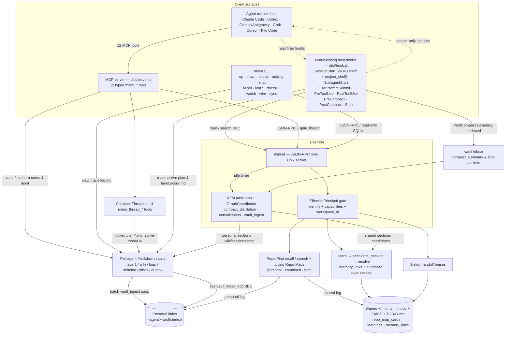

# Architecture

## Surfaces and request flow

The README's [architecture diagram](../README.md#architecture-at-a-glance) is
the control plane in summary — the ingresses, the gate, the core verbs, and the
stores. This diagram shows the full v1 surface map: client runtimes, non-blocking
hooks, the 12-tool MCP bridge, the stdlib-only `minni` CLI, the governed daemon,
the typed memory graph, Living Repo Maps, and the operator-facing `~/.minni/TODAY.md`
digest. Dashed edges are **host-mediated** — the platform fires the hook and
consumes what it returns; solid edges are direct calls.

One daemon per host; one plugin process per agent runtime; for daemon-mediated
operations, identity is stamped server-side (`EffectivePrincipal`, the single
source of identity) — callers cannot claim capabilities. Plugin-local vault-note
and audit writes do not cross this boundary; see
[security](security.md#identity-and-capability-gating).

## Components

| Component | Responsibility |
|---|---|
| `src/minni/minnid.py` | JSON-RPC daemon, dispatch, policy, storage, status, and background `TODAY.md` sweeps |
| `src/minni/principal.py` | Identity resolution, vault roots, capabilities, and workspace/privacy read authorization |
| `src/minni/retrieval.py` (`trie_index.py`, `fts_search.py`, `semantic_rerank.py`) | Repo-First hybrid Tier 1 Trie (`< 0.5 ms`) + Tier 2 FTS5 BM25 (`< 10 ms` `mode="fast"`) + FAISS/RRF/Cross-Encoder rerank with strict confidence floor across all hits |
| `src/minni/repo_map.py` | Living Repo Maps (`minni map`) synthesizing file-and-SHA-pinned Subsystem Cards (`~/.minni/vault/maps/<workspace>/` + `repo_map_cards`) with git-diff staleness stamps |
| `src/minni/graph_coordinator.py` (`edge_classifier.py`, `graph_expansion.py`) | Typed memory graph (`updates`, `contradicts`, `extends`, `relates` in `memory_links` / `learning_links`) and automatic supersession |
| `src/minni/today_digest.py` | Auto-maintained plain-Markdown `~/.minni/TODAY.md` (`0600`) operator digest |
| `src/minni/db.py` | Shared SQLite schema and migrations (`workspace_id`, `repo_map_cards`, `memory_links`, `candidate_packets`, `handoff_leases`) |
| `src/minni/afm_passes/` | Background curation passes (see [concepts](concepts.md#the-afm-pass-pipeline)) |
| `src/minni/minni_cli.py` | Stdlib-only first-class CLI: `up`, `down`, `status`, `activity`, `map`, `recall`, `learn`, `doctor`, `watch`, `wire`, `wire-adopt`, `sync` |
| `plugins/minni/src/server.ts` | 12-tool MCP registration, compact `< 2 KB` Thread payload enforcement, and request shaping |
| `plugins/minni/src/hook-handlers.ts` & `agent_envelope.ts` | Non-blocking host hooks, Two-Part Permanent Boot Shelf (`layer1/core.md` up to `24 KB` + `project_shelf` `<= 2,500` chars), and `PostCompact` shelf recovery |
| `plugins/minni/src/plan.ts` & `thread-notification-relay.ts` | Durable plan artifacts, file-locked slice transitions, per-session active pointers, and `<agent>:<sessionKey>` relay cursors |
| `plugins/minni/src/vault.ts` | Vault-first learning notes, inbox/outbox packets, audit trail, and offline lexical fallback |

## Data model

| Surface | Contents |
|---|---|
| Shared `~/.minni/minni.db` (SQLite, FTS5, WAL) | `workspace_id`-scoped `learnings` and `documents`, `repo_map_cards`, typed `memory_links` / `learning_links`, `candidate_packets`, `handoff_leases`, episodic/contradiction events, migrations, and `chunk_embeddings` |
| Shared FAISS & Tier 1 Trie | Vector index and in-memory lexical Trie for the shared document leg |
| Living Repo Maps (`~/.minni/vault/maps/<workspace>/`) | Subsystem Map Cards (`*.md`) and `_index.json` pinned to owning file paths and `git` HEAD SHA, indexed into SQLite + live FAISS/Trie |
| Human digest (`~/.minni/TODAY.md`, mode `0600`) | Auto-maintained plain-Markdown summary of system health, genuine rule conflicts, live sessions/plans/handoffs, 24h project learnings/scars, and map freshness |
| Per-agent `<agent>-vault/.index/` | `vault.db` (chunk text, embeddings, resolved `[[wikilink]]` edges) + `vault.faiss` + `vault.manifest.json`, built from that agent's `wiki/**/*.md` |
| Vault `layer1` / `wiki` / `logs` / `schema` / `inbox` / `outbox` / `.runtime` | Standing agent identity (`layer1/core.md`), synthesis/plan/session notes, append-oriented audit trail (`log.md`), hook/candidate inbox packets, outgoing handoffs, and session-scoped runtime pointers |

Recall scope semantics and provenance are covered in
[concepts — two-tier storage](concepts.md#two-tier-storage).

## MCP tools (12-tool v1 surface)

`plugins/minni/src/server.ts` registers exactly **12 self-explanatory MCP tools** — call them literally as written (there is no family/action dispatch layer, and pre-v1 orchestration/vault/audit tool aliases have been retired in favor of these 12 tools and the `minni` CLI):

| Group | Tool | Purpose |
|---|---|---|
| **Core Memory & Repo Context (6)** | `minni_recall` | Repo-First hybrid search across Living Repo Maps, project docs, learnings, and scars |
| | `minni_drill` | Expand `m:<8hex>` handles, `d:<src>:<id>` refs, chunk/result IDs, or wikilinks (including repo-map path wikilinks and typed `memory_links`) |
| | `minni_learn` | Vault-first quality/secret gate + candidate staging or durable workspace-tagged storage |
| | `minni_list_candidates` | List pending `proposed` learning candidates scoped to the caller principal |
| | `minni_resolve_candidate` | Accept, reject, redact, merge, or supersede staged candidates |
| | `minni_status` | Snapshot of daemon health, AFM provider state, vault path, audit summary, and 7-day recall-to-use stats |
| **Handoff (2)** | `minni_handoff_send` | 1-step session or cross-agent handoff packet (`< 1 KB` lease receipt) |
| | `minni_handoff_inbox` | Preview pending handoffs addressed to this agent and acknowledge a `lease_id` or inline-clear (`ack: true`) |
| **Threads / Shared Plans (4)** | `minni_thread_create` | Create a shared multi-slice plan in the vault (`< 2 KB` receipt, per-session `activate`) |
| | `minni_thread_status` | Read compact `< 2 KB` plan progress, next action, capped scar previews, and optional shelf drift |
| | `minni_thread_update` | Advance slice status under file lock (`< 2 KB` compact response, no worker lease tokens, `depends_on` & `evidence` enforced) or toggle per-session `activate` |
| | `minni_thread_scar` | Record a `failed_command`, `dead_end`, or `rejected_hypothesis` (`< 1 KB` receipt) and promote workspace scar context |

### Thread execution & multi-session isolation

- **Compact, lock-serialized mutations**: `minni_thread_create`, `minni_thread_status`, and `minni_thread_update` enforce a `< 2 KB` compact response budget (`serializeCompactBudget`), keeping full `scar_tissue` history on disk (`plan-*.md` + `plan-*.log.md`) unless `include_full_plan: true` is explicitly requested. `minni_thread_update` serializes writes under `withThreadPlanLock` with zero worker claim tokens or idempotency keys, requiring `evidence` before marking a slice `done` and enforcing `depends_on` unless `force` and a non-empty `force_reason` are supplied.
- **Per-session active pointers & notification relay**: Concurrent windows of the same principal isolate their active plan pointers under `<vault>/.runtime/active-thread.d/<sessionKey>.json` (preserving the frozen `_active_plan.json` mirror when single-session) and track journal events through composite `<agent>:<sessionKey>` relay cursors (`.runtime/thread-relay/cursors.json`, paired with `src/minni/thread_relay.py`). Hooks read pending attention deltas without polling separate event tools; dead-session pointers and cursors are swept automatically while preserving durable plan Markdown files.

## Observability

The `status` RPC returns daemon and engine health plus operational metrics
(per-method `latencies`, `errors`, `counters`); `health_report` adds deeper
diagnostics (index freshness, decay coverage, contradicting learnings,
vector-backend sync lag), redacted to aggregate counts unless the caller is a
stamped operator. Operators inspect live state without any localhost web UI
server via `minni status` (4-line plain-English overview + latencies),
`minni activity` and `~/.minni/TODAY.md` (`0600` daily digest), `minni watch`
(live vault + daemon event tail), `minni doctor` (end-to-end socket, recall,
cache, and 9-host fleet drift checks), and the `minni_status` MCP tool.

## Continuity & Non-Blocking Hooks

- **Two-Part Permanent Boot Shelf (`SessionStart` / `SubagentStart`)**: `fitEnvelope` loads (1) the **Agent Permanent Shelf** (`layer1/core.md` up to `24 KB` un-truncated, sized against JSON-serialized headroom) for standing identity and rules, and (2) the **Project Permanent Shelf** (`project_shelf`, `<= 2,500` chars) with the current repository's Subsystem Map Cards, git-diff staleness notices, top active scars, and active plan summary — exempt from proportional floor crushing, with one-shot `PostCompact` -> `UserPromptSubmit` shelf recovery after compaction.
- **Lifecycle spine**: On Claude Code, `<minni:context>` carries the compact v1 lifecycle spine (`recall → drill → thread → learn`), configurable via `MINNI_LIFECYCLE_NUDGE_MODE` (`off` disables).
- **Strictly non-blocking hooks across all hosts**: Hooks across Claude Code, Codex, Gemini/Antigravity, Grok Build, Cursor, and Kilo Code inject context only and **never** emit `permissionDecision: "deny"` or block `Read`, `Grep`, `Glob`, `Bash`, or edit calls. When strong recall for a turn is unconsulted, `PreToolUse` (`MINNI_RECALL_GUARD_MODE` = `off` / `soft` / `strict`) attaches up to 3 top hits non-blockingly via `hookSpecificOutput.additionalContext` (`continue: true`) once per arming on hosts declaring `preToolUseContext: true` (Claude Code), and records non-blocking telemetry (`{continue: true}`) on all other hosts. `UserPromptSubmit` skips synthetic `<task-notification>`, `<SYSTEM_MESSAGE>`, `[Message] timestamp=`, and `<background-task>` wakeups, while `PostToolUse` restricts failure-lesson checks strictly to file edits and failed commands. Full per-host hook matrix: [docs/contracts/hook-platforms.md](contracts/hook-platforms.md).
