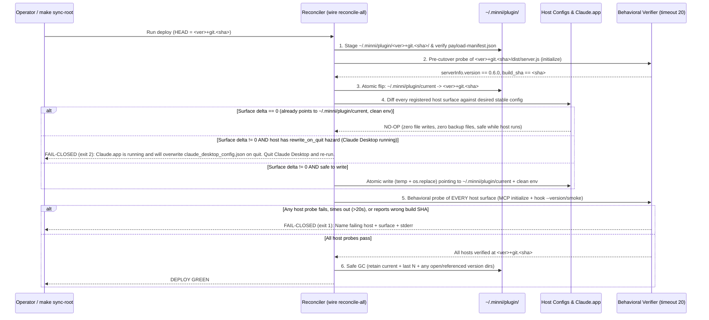

# Design: Hermetic Host Update Propagation & Zero-Drift Fleet Reconcile

- **Status:** Draft (Research + Design Spike; zero product-code changes in this commit)
- **Author:** Argon (`gemini-4-argon`)
- **Base Commit:** `af0c04f7` (`main`)
- **Supersedes / Extends:** [`docs/design/DESIGN-wire-claude-plugin-adoption.md`](DESIGN-wire-claude-plugin-adoption.md)

---

## 1. Problem Statement & Core Invariant

Minni runs across a heterogeneous fleet of local agent hosts: Claude Code (CLI + plugin marketplace), Claude Desktop, Codex, Gemini CLI, Antigravity (IDE, CLI, and Desktop app surfaces), Grok / Grok-build, Cursor, KiloCode, Devin, Windsurf, and Muse.

Today, deploys (`make sync-root` -> `scripts/update_root.sh` and `minni sync` -> `src/minni/fleet_sync.py`) split host management across three partially overlapping mechanisms:
1. `minni wire all --from-repo` (`src/minni/wire/flow.py`), which writes **version-pinned paths** (`~/.minni/plugin/<version>+git.<sha>/dist/server.js`) directly into some host configs while deliberately leaving `~/.minni/plugin/current` unmaintained on `--from-repo` installs (`src/minni/wire/install.py:134`).
2. `custom_refresh.py` (`src/minni/wire/custom_refresh.py`), which rewrites custom JSON bindings recorded in `wired.json` (`muse`, `devin`) to version-pinned paths while leaking `.minni-backup-*` files on every deploy.
3. `propagate.py` (`plugins/minni/skills/minni-install/scripts/propagate.py`), which copies files in place for `antigravity` (`~/.agents/plugins/minni@minni`) and `cursor` (`~/.cursor/plugins/local/minni`), and stamps version-pinned paths into `~/.grok/hooks/minni.json`.

This split caused three verified classes of production failure (plus 22 additional defects cataloged in §3):
- **D1 (Versioned-Path Pin & In-Memory Config Hazard, Claude Desktop):** `minni wire-adopt claude-code` (`src/minni/wire/claude_plugin.py:575-641`) rewrote `claude_desktop_config.json` to a SHA-pinned directory `~/.minni/plugin/0.6.0+git.<sha>/dist/server.js` without recording `claude-desktop` in `~/.minni/plugin/wired.json`. Subsequent deploys and GC pruned the old SHA directory, leaving Claude Desktop failing with `MODULE_NOT_FOUND`. Worse, Claude Desktop holds `claude_desktop_config.json` in memory and rewrites it on quit (`main.log`: `"Config file written"`), silently reverting any on-disk edit made while `Claude.app` is running.
- **D2 (Install-Time Identity Pinning):** Both `wire` (`src/minni/wire/flow.py:165`, `writers.py:206,301,327,364,753`, `kilo.py:89`, `custom_refresh.py:200`) and `propagate.py` (`propagate.py:620,676,698,721,755,993,1460,1584`) stamp a static `MINNI_WORKSPACE_ID` (typically `"workspace-minni"` or `"workspace-<operator>"`) and/or `"cwd": "<install_root>"` into host MCP configs at install time. At runtime, `DEFAULT_WORKSPACE_ID` (`plugins/minni/src/config.ts:529-535`) prioritizes `process.env.MINNI_WORKSPACE_ID` over `deriveWorkspaceIdFromCwd()`, attributing every session on hookless or wrapper-launched hosts to `"workspace-minni"` regardless of the active project.
- **D3 (Dangling-Symlink Trust & Lexicographic SHA Sorting):** `propagate.py:99-100` (`plugin_version_segment()`) checked `current.is_symlink()` before `current.exists()`, trusting a dangling `~/.minni/plugin/current` symlink as authoritative and stamping its dead SHA into `gemini-extension.json`. When `current` is absent, `max_present_version()` (`propagate.py:59-84`) sorts `+git.<sha>` suffixes lexicographically by hex SHA rather than commit/install timestamp, picking arbitrary older builds whose hex SHA sorts higher than `HEAD`.

### The Core Invariant

> **DEPLOY CONVERGENCE INVARIANT:**
> After any Minni deploy (`make sync-root`, `minni sync`, or `minni wire all`), **every connected host surface** (MCP server, lifecycle hook, native bridge, plugin manifest, and rule overlay) resolves to and launches the newly deployed build with dynamic per-session workspace identity, **or the deploy fails closed (non-zero exit)** naming every host surface that could not be updated or verified.

---

## 2. Phase 1 Inventory: Host Surfaces & Code Provenance

The table below captures all 25 host surfaces across the 12 host families discovered on the reference machine (`HEAD` = `0.6.0+git.af0c04f7`). Machine-specific raw probe outputs are stored in `_private/host_probe_results.json` (gitignored); synthetic paths (`~`) are used below.

| # | Host / Surface | Config File & Key | Server / Hook Target Path | Path Kind Today | Exists & MCP `initialize` Probe (`timeout 20`, scratch cwd) | Code Path That Wrote It (`file:line`) | Refreshed by `make sync-root`? (Proven by call graph) | Hardcoded Identity in `env` / Wrapper | Host Rewrites Config from Memory? |
|---|---|---|---|---|---|---|---|---|---|
| 1 | **Claude Code (MCP)** | `~/.claude.json` -> `mcpServers.minni` | `node ~/.minni/plugin/0.6.0+git.af0c04f7/dist/server.js` | `VERSIONED` | Exists; `rc=0`, `minni@0.6.0` (157.8 ms) | `wire`: `src/minni/wire/writers.py:286-305` (`update_claude_config`) | **Yes** (`update_root.sh:239` -> `wire all` -> `flow.py:305`) | `MINNI_AGENT_ID=claude-code`, `MINNI_VAULT_PATH=~/.minni/claudecode-vault`, **`MINNI_WORKSPACE_ID=workspace-minni` (WRONG: static pin)** | **Yes** (`claude` CLI writes `~/.claude.json.tmp.<pid>` from memory throughout session) |
| 2 | **Claude Code (Plugin Registry + Hooks)** | `~/.claude/plugins/installed_plugins.json` -> `plugins["minni@minni"][0].installPath` | `~/.minni/plugin/0.6.0+git.af0c04f7` (loads `.claude-plugin/plugin.json` + `hooks/hooks.json` -> `dist/hook.js` + duplicate MCP `dist/server.js`) | `VERSIONED` | Exists; `rc=0`, `minni@0.6.0` (157.1 ms) | `wire`: `src/minni/wire/claude_plugin.py:323-360` (`_register_direct`) | **Yes** (`update_root.sh:239` -> `flow.py:585-635`) | `.mcp.json` inside payload has **`MINNI_WORKSPACE_ID=workspace-minni` (WRONG)**; also registers duplicate MCP server `mcp__plugin_minni_minni__*` | **Partial** (`claude /plugin` commands rewrite `installed_plugins.json`) |
| 3 | **Claude Code (Local Marketplace)** | `~/.claude/local-marketplaces/minni/.claude-plugin/marketplace.json` | Symlink `plugins/minni-0.6.0` -> `~/.minni/plugin/0.6.0+git.af0c04f7` | `VERSIONED` (symlink target) | Exists (directory symlink) | `wire`: `src/minni/wire/claude_plugin.py:238-315` (`_stage_marketplace`) | **Yes** (`flow.py:585-635`) | None in `marketplace.json` | No |
| 4 | **Claude Desktop (MCP)** | `~/Library/Application Support/Claude/claude_desktop_config.json` -> `mcpServers.minni` | `/opt/homebrew/bin/node ~/.agents/plugins/Minni@Minni/dist/server.js` (operator manual hotfix after D1 outage) | `STABLE` (manual hotfix; `wire-adopt` writes `VERSIONED`) | Exists; `rc=0`, `minni@0.6.0` (156.0 ms) | Manual hotfix after `claude_plugin.py:575-641` (`_move_desktop_arg`) left it on pruned `0.6.0+git.de211faf`; `propagate.py:950-1012` also writes here | **No** (`follow_claude_desktop` at `claude_plugin.py:612` skips because arg is not under `~/.minni/plugin`; `propagate` for `claude` is not called by `update_root.sh`) | `MINNI_AGENT_ID=claude-code`, `MINNI_VAULT_PATH=~/.minni/claudecode-vault` (`MINNI_WORKSPACE_ID` manually removed; `propagate.py:993` stamps `workspace-minni`) | **YES (CRITICAL): `Claude.app` holds config in RAM and overwrites `claude_desktop_config.json` on quit** |
| 5 | **Codex (MCP)** | `~/.codex/config.toml` -> `[mcp_servers.minni]` | `node ~/.minni/plugin/0.6.0+git.af0c04f7/dist/server.js` | `VERSIONED` | Exists; `rc=0`, `minni@0.6.0` (144.2 ms) | `wire`: `src/minni/wire/writers.py:706-773` (`update_toml_mcp_config`) | **Yes** (`update_root.sh:239` -> `flow.py:309`) | `MINNI_AGENT_ID=codex`, `MINNI_VAULT_PATH=~/.minni/codex-vault` (no `MINNI_WORKSPACE_ID` today, though `_resolve_codex_env` at `writers.py:267` preserves any stale pin unless `--dynamic-workspace` is passed) | **Partial** (`codex` rewrites `config.toml` when trust/MCP/model settings change) |
| 6 | **Codex (Hooks)** | `~/.codex/hooks.json` -> `hooks.{SessionStart,UserPromptSubmit,PreToolUse,Stop}` | `node ~/.minni/plugin/0.6.0+git.af0c04f7/dist/codex-hook.js <Event>` | `VERSIONED` | Exists (`codex-hook.js` present) | `wire`: `src/minni/wire/writers.py:591-647` (`update_codex_hooks`) | **Yes** (`update_root.sh:239` -> `flow.py:322`) | Env in payload `.mcp.json` (`MINNI_CODEX_AGENT_ID=codex`, `MINNI_CODEX_VAULT_PATH=~/.minni/codex-vault`) | No |
| 7 | **Gemini CLI (`settings.json`)** | `~/.gemini/settings.json` -> `mcpServers.minni` | `node ~/.agents/plugins/minni@minni/dist/server.js` | `STABLE` (in-place copy) | Exists; `rc=0`, `minni@0.6.0` (168.7 ms) | Legacy `propagate.py` / manual (`writers.py` and `propagate.py` no longer touch `~/.gemini/settings.json`) | **Only indirectly** (target `minni@minni/dist/server.js` is refreshed by `propagate --platform antigravity`, but `settings.json` itself is never reconciled) | `MINNI_AGENT_ID=gemini`, `MINNI_VAULT_PATH=~/.minni/gemini-vault`, **`MINNI_WORKSPACE_ID=workspace-minni` (WRONG: static pin)** | **Yes** (`gemini` CLI rewrites `settings.json` on setting/extension changes) |
| 8 | **Gemini CLI Extension (`extensions/minni`)** | `~/.gemini/extensions/minni/.gemini-plugin/gemini-extension.json` & `mcp.json` | `node ~/.gemini/extensions/minni/dist/server.js` & `npx tsx ~/Projects/Minni/plugins/minni/src/sovereign.ts` | `STABLE` (orphaned copy) | **STALE / BROKEN TODAY:** `dist/server.js` answers `minni@0.3.0` (`build-manifest.json` `0.5.0`/`c3aaa922`); `mcp.json` `sovereign.ts` does not exist | Legacy `gemini extensions install` / pre-v0.6 copy | **No** (completely untracked by `wire`, `propagate.py`, `check_deployments.py`, and `check_versions.py`) | `MINNI_WORKSPACE_ID=default` / `SOVEREIGN_WORKSPACE_ID=default`, `SOVEREIGN_VAULT_PATH=~/.sovereign-memory/gemini-vault` (**WRONG**) | No |
| 9 | **Antigravity Surface 1 (`~/.gemini/config`)** | `~/.gemini/config/mcp_config.json` (symlink -> `../antigravity/mcp_config.json`) -> `mcpServers.minni` | `~/.agents/bin/mcp-env-run node ~/.agents/plugins/minni@minni/dist/server.js` | `STABLE` (in-place copy) | Exists; `rc=0`, `minni@0.6.0` (159.0 ms) | `propagate.py:911-942` (`update_antigravity_config`) & `writers.py:514-539` | **Yes** (`update_root.sh:314` -> `propagate --platform antigravity`) | `MINNI_AGENT_ID=gemini`, `MINNI_VAULT_PATH=~/.minni/gemini-vault`, **`MINNI_WORKSPACE_ID=workspace-minni` (WRONG)** | **Partial** (Antigravity UI rewrites `mcp_config.json` on MCP toggle) |
| 10 | **Antigravity Surface 2 (`~/.gemini/antigravity`)** | `~/.gemini/antigravity/mcp_config.json` -> `mcpServers.minni` | `~/.agents/bin/mcp-env-run node ~/.agents/plugins/minni@minni/dist/server.js` | `STABLE` (in-place copy) | Exists; `rc=0`, `minni@0.6.0` (156.1 ms) | `propagate.py:911-942` / `writers.py:514-539` | **Yes** (`update_root.sh:314`) | **`MINNI_WORKSPACE_ID=workspace-minni` (WRONG)** | **Partial** |
| 11 | **Antigravity Surface 3 (`~/.gemini/antigravity-ide`)** | `~/.gemini/antigravity-ide/mcp_config.json` -> `mcpServers.minni` | `~/.agents/bin/mcp-env-run node ~/.agents/plugins/minni@minni/dist/server.js` | `STABLE` (in-place copy) | Exists; `rc=0`, `minni@0.6.0` (156.3 ms) | `propagate.py:911-942` / `writers.py:514-539` | **Yes** (`update_root.sh:314`) | **`MINNI_WORKSPACE_ID=workspace-minni` (WRONG)** | **Partial** |
| 12 | **Antigravity Surface 4 (`~/.gemini/antigravity-cli`)** | `~/.gemini/antigravity-cli/plugins/minni/mcp_config.json` -> `mcpServers.minni` | `~/.agents/bin/mcp-env-run node ~/.agents/plugins/minni@minni/dist/server.js` | `STABLE` (in-place copy) | Exists; `rc=0`, `minni@0.6.0` (159.2 ms) | `propagate.py:911-942` / `writers.py:514-539` | **Yes** (`update_root.sh:314`) | **`MINNI_WORKSPACE_ID=workspace-minni` (WRONG)** | **Partial** |
| 13 | **Antigravity Native Hooks** | `~/.gemini/config/plugins/minni/hooks.json` -> `hooks.*` | `node ~/.agents/plugins/minni@minni/dist/gemini-hook.js <Event>` | `STABLE` (via `propagate`; `VERSIONED` if `wire gemini` runs!) | Exists (`gemini-hook.js` present) | `propagate.py:1218-1231` (`update_antigravity_hooks`) or `writers.py:542-588` (`update_agy_plugin_hooks`) | **Yes** (`update_root.sh:314`) | `MINNI_GEMINI_AGENT_ID=gemini`, `MINNI_GEMINI_VAULT_PATH=~/.minni/gemini-vault` | No |
| 14 | **Shared Agents Tree (`Minni@Minni`)** | `~/.agents/plugins/Minni@Minni/{.mcp.json,gemini-extension.json}` & `~/.agents/mcp-servers/views/.gemini__*` | `node ~/.agents/plugins/Minni@Minni/dist/server.js` (`node_modules` is a symlink into `~/Projects/Minni/plugins/minni/node_modules`) | `STABLE` (in-place copy) | Exists; `rc=0`, `minni@0.6.0` (142.5 ms); **DRIFT: root `gemini-extension.json` has `"version": "0.6.0+git.6feffaa3"` (D3)** | `propagate.py:610-632, 703-738` | **Partial** (`propagate --platform antigravity` copies files, but `gemini-extension.json` kept `0.6.0+git.6feffaa3` from D3, and `~/.agents/mcp-servers/views/.gemini__*` are unlinked from `~/.gemini/antigravity*`) | `.mcp.json` & `gemini-extension.json` have **`MINNI_WORKSPACE_ID=workspace-<operator>` (WRONG)** | No |
| 15 | **Grok / Grok-build (MCP)** | `~/.grok/config.toml` -> `[mcp_servers.minni]` | `node ~/.minni/plugin/0.6.0+git.af0c04f7/dist/server.js` | `VERSIONED` | Exists; `rc=0`, `minni@0.6.0` (141.4 ms) | `wire`: `src/minni/wire/writers.py:706-773` (`update_toml_mcp_config`) | **Yes** (`update_root.sh:239` -> `flow.py:309`) | `MINNI_AGENT_ID=grok-build`, `MINNI_VAULT_PATH=~/.minni/grok-build-vault`, **`MINNI_WORKSPACE_ID=workspace-<operator>` (WRONG: preserved forever by `writers.py:680`)** | **Yes** (`grok` CLI locks and rewrites `config.toml` on trust/setting changes) |
| 16 | **Grok / Grok-build (Hooks Overlay 1)** | `~/.grok/hooks/minni.json` -> `hooks.*` | `node ~/.minni/plugin/0.6.0+git.af0c04f7/dist/grok-hook.js <Event>` | `VERSIONED` | Exists (`grok-hook.js` present) | `propagate.py:1147-1160` (`update_grok_hooks`) called by `update_root.sh:369` / `fleet_sync.py:336` | **Yes** (`update_root.sh:369`, unless `minni sync --wire-only` is used) | `MINNI_GROK_AGENT_ID=grok-build`, `MINNI_GROK_VAULT_PATH=~/.minni/grok-build-vault` | No |
| 17 | **Grok / Grok-build (Top-Level `hooks.json`)** | `~/.grok/hooks.json` -> `hooks.{SessionStart,UserPromptSubmit,PreToolUse,PreCompact,Stop}` | `node ~/.minni/plugin/current/dist/grok-hook.js <Event>` | `STABLE` (dangling target!) | **BROKEN TODAY (`MODULE_NOT_FOUND`):** `~/.minni/plugin/current` does not exist! | Legacy `propagate.py` / manual install before `hooks/minni.json` split | **No** (`propagate.py:1018` only writes `~/.grok/hooks/minni.json`, leaving `~/.grok/hooks.json` pointing at missing `current`) | `MINNI_GROK_AGENT_ID=grok-build`, `MINNI_GROK_VAULT_PATH=~/.minni/grok-build-vault` | No |
| 18 | **Grok / Grok-build (Rules)** | `~/.grok/rules/minni.md` | Static markdown (invokes `node ~/.minni/plugin/current/dist/cli.js` in fallback docs) | `STABLE` | Exists | `propagate.py:1163-1182` (`write_grok_rules`) | **Yes** (`update_root.sh:370`) | `agent=grok-build` | No |
| 19 | **Cursor (MCP Launcher & Lanes)** | `~/.cursor/mcp.json` -> `mcpServers.{minni,minni-w5,minni-swift,minni-widget,minni-cos,minni-shop,minni-agent,minni-inbox}` | `~/.local/bin/minni-mcp --lane <lane>` -> `exec node ~/.cursor/plugins/local/minni/dist/server.js` | `STABLE` (wrapper -> in-place copy) | Exists; `rc=0`, `minni@0.6.0` (210.6 ms) | Operator wrapper `~/.local/bin/minni-mcp` (not managed by `wire` or `propagate.py`) | **Indirectly** (`propagate --platform cursor` updates `~/.cursor/plugins/local/minni`, which `minni-mcp` execs) | **`minni-mcp` sets `MINNI_WORKSPACE_ID=${MINNI_WORKSPACE_ID:-workspace-<user>}` (or `default`) and `cd ~/.cursor/plugins/local/minni` (WRONG: pins workspace and clobbers `cwd`)** | **Partial** (Cursor Settings UI rewrites `~/.cursor/mcp.json` when MCP servers are toggled) |
| 20 | **Cursor (Local Plugin & Hooks)** | `~/.cursor/plugins/local/minni/.mcp.json`, `~/.cursor/hooks.json`, `~/.cursor/hooks/minni-cursor.sh` | `./hooks/minni-cursor.sh <event>` -> `exec node ~/.cursor/plugins/local/minni/dist/cursor-hook.js` | `STABLE` (in-place copy) | Exists; `rc=0`, `minni@0.6.0` (141.7 ms) | `propagate.py:1234-1291` (`update_cursor_hooks`, `deploy_cursor_wrapper`) | **Partial** (`minni-cursor.sh` is **never updated** under `--existing-only` due to early return at `propagate.py:1066-1074`!) | `.mcp.json` stamps **`MINNI_WORKSPACE_ID=workspace-minni` (WRONG)**; `minni-cursor.sh` sets `MINNI_CURSOR_AGENT_ID=cursor` | No |
| 21 | **KiloCode (MCP)** | `~/.config/kilo/kilo.json` (`kilo.jsonc`) -> `mcp.minni` | `["node", "~/.minni/plugin/0.6.0+git.af0c04f7/dist/server.js"]` | `VERSIONED` | Exists; `rc=0`, `minni@0.6.0` (139.1 ms) | `wire`: `src/minni/wire/writers.py:308-334` (`update_kilo_config`) | **Yes** (`update_root.sh:239` -> `flow.py:307`) | `MINNI_AGENT_ID=kilocode`, `MINNI_VAULT_PATH=~/.minni/kilocode-vault`, **`MINNI_WORKSPACE_ID=workspace-minni` (WRONG: static pin)** | **Partial** (Kilo CLI/UI rewrites `kilo.json` on MCP edits) |
| 22 | **KiloCode (Native Hook Bridge)** | `~/.config/kilo/plugin/minni.js` -> `__MINNI_KILO_HOOK_SCRIPT__` | `~/.minni/plugin/0.6.0+git.af0c04f7/dist/kilocode-hook.js` | `VERSIONED` | Exists (`kilocode-hook.js` present) | `wire`: `src/minni/wire/kilo.py:72-121` (`install_kilo_bridge`) | **Conditional** (`flow.py:260-288` skips if `minni.js` is absent or lacks marker during `wire all`) | **`MINNI_KILOCODE_WORKSPACE_ID=workspace-minni` (WRONG: static pin at `kilo.py:89`)** | No |
| 23 | **Devin (MCP)** | `~/.config/devin/mcp_config.json` -> `mcpServers.minni` (`cwd` + `args`) | `/opt/homebrew/bin/node ~/.minni/plugin/0.6.0+git.af0c04f7/dist/server.js` | `VERSIONED` | Exists; `rc=0`, `minni@0.6.0` (141.6 ms); **23 `.minni-backup-*` files leaked in `~/.config/devin/`** | `custom_refresh.py:173-242` (`_refresh`) | **Yes** (`update_root.sh:275` -> `refresh_custom_wires`) | `MINNI_AGENT_ID=devin`, `MINNI_VAULT_PATH=~/.minni/devin-vault`, **`MINNI_WORKSPACE_ID=workspace-praxis` (WRONG: conflicts with `wired.json` `workspace-playbook-engineering`), plus `cwd` pinned to `install_root`!** | **Partial** (`devin mcp` rewrites `mcp_config.json`) |
| 24 | **Devin (Lifecycle Hooks)** | `~/.config/devin/config.json` -> `hooks.{SessionStart,UserPromptSubmit,PreToolUse,PostCompaction,Stop}` -> `~/.config/devin/scripts/minni-hook.sh` | `exec /opt/homebrew/bin/node ~/.minni/plugin/devin/dist/hook.js "$1"` | `STABLE` (dangling target!) | **BROKEN TODAY (`MODULE_NOT_FOUND`):** `~/.minni/plugin/devin` does not exist! Also sets `MINNI_AFM_NATIVE_HELPER=~/Projects/Minni/src/minni/native_afm_helper` (missing) | Manual / legacy setup script | **No** (completely unknown to `wire`, `custom_refresh.py`, `propagate.py`, and `check_deployments.py`) | **`project_dir` defaults to `~/Projects/playbook-engineering` and sets `MINNI_CLAUDECODE_WORKSPACE_ID=workspace-playbook-engineering` (WRONG)** | **Yes** (`devin` CLI dynamically appends `Exec(...)` rules to `~/.config/devin/config.json`) |
| 25 | **Muse (MCP & Settings)** | `~/.muse/mcp.json` -> `mcpServers.minni` vs `~/.config/muse/settings.json` -> `mcpServers` | `/opt/homebrew/bin/node ~/.minni/plugin/0.6.0+git.af0c04f7/dist/server.js` (in `~/.muse/mcp.json`; **absent from `~/.config/muse/settings.json`!**) | `VERSIONED` | `~/.muse/mcp.json`: `rc=0`, `minni@0.6.0` (141.4 ms); **`~/.config/muse/settings.json` has NO `minni` entry**; **23 `.minni-backup-*` files leaked in `~/.muse/`** | `custom_refresh.py:173-242` (`_refresh`) | **Partial** (`~/.muse/mcp.json` is refreshed, but `~/.config/muse/settings.json` — which Muse CLI actually reads — has no `minni` server!) | **`MINNI_WORKSPACE_ID=workspace-minni` and `cwd` pinned to `install_root` (WRONG)** | **Yes** (Muse locks `.settings.json.lock` and rewrites `~/.config/muse/settings.json` from memory) |

*(Note on **Windsurf**: `~/.codeium/windsurf/mcp_config.json` exists on disk with `typesafe`, `persona-hub`, and `axpress`, and has no `minni` binding today. Under `host_discovery.py`, Windsurf is not registered as a separate platform spec.)*

---

## 3. Adversarial Sweep of `src/`, `scripts/`, and `plugins/minni/` (`NEW` Findings)

Every site that writes a SHA-pinned path, stamps an install-time workspace ID, trusts an unvalidated symlink, or fails to detect host drift is listed below, triaged with **Blockers Today** (a host or invariant is actively broken on the live machine today) before **Latent Defects**.

### 3.1 Blockers Today

1. `NEW: ~/.grok/hooks.json & plugins/minni/skills/minni-install/scripts/propagate.py:1018,1147-1160 · propagate.py only updates ~/.grok/hooks/minni.json while ~/.grok/hooks.json remains pointed at nonexistent ~/.minni/plugin/current/dist/grok-hook.js · grok / grok-build`
   - Live `~/.grok/hooks.json` invokes `node ~/.minni/plugin/current/dist/grok-hook.js <Event>` across all 5 hook events (`SessionStart`, `UserPromptSubmit`, `PreToolUse`, `PreCompact`, `Stop`), failing with `Cannot find module` because `~/.minni/plugin/current` is absent on `--from-repo` machines.

2. `NEW: ~/.config/devin/config.json:57-113 & ~/.config/devin/scripts/minni-hook.sh:7-20 · Devin lifecycle hooks execute ~/.minni/plugin/devin/dist/hook.js which does not exist on disk and hardcodes playbook-engineering workspace · devin`
   - All 5 Devin lifecycle hooks fail because `~/.minni/plugin/devin` does not exist; neither `wire`, `custom_refresh.py`, nor `check_deployments.py` knows about `~/.config/devin/config.json` or `~/.config/devin/scripts/minni-hook.sh`.

3. `NEW: ~/.gemini/extensions/minni/.gemini-plugin/gemini-extension.json & scripts/check_deployments.py:52-65 · Orphaned ~/.gemini/extensions/minni deployment runs stale 0.3.0/0.5.0 server.js and broken sovereign.ts mcp.json while invisible to all checkers · gemini`
   - Answering MCP `initialize` today with `serverInfo: {"name": "minni", "version": "0.3.0"}`; completely omitted from `DEPLOYMENT_GLOBS` in `check_deployments.py` and `check_versions.py`.

4. `NEW: ~/.config/muse/settings.json:69-85 & src/minni/wire/custom_refresh.py:173-242 · custom_refresh updates ~/.muse/mcp.json while Muse's active ~/.config/muse/settings.json mcpServers lacks minni · muse`
   - `wired.json` tracks `~/.muse/mcp.json`, whereas Muse's runtime configuration at `~/.config/muse/settings.json` only registers `typesafe`, `workbench`, and `xcode`.

5. `NEW: plugins/minni/skills/minni-install/scripts/propagate.py:59-84 · max_present_version() sorts +git.<sha> local version segments lexicographically by random hex SHA instead of commit/install time · all propagate callers`
   - `_version_sort_key` returns `(tuple(release), 1 if local else 0, local)`. Because `local` is `"git.<sha>"`, `max()` picks whichever version directory has the highest hex SHA (e.g., `git.de211faf` > `git.af0c04f7`), stamping stale versions into manifests whenever `~/.minni/plugin/current` is absent.

6. `NEW: plugins/minni/src/config.ts:526-535 · DEFAULT_WORKSPACE_ID prioritizes process.env.MINNI_WORKSPACE_ID over deriveWorkspaceIdFromCwd(), which is always populated by wire/propagate install-time stamping · all hosts`
   - Because `wire` and `propagate.py` stamp `MINNI_WORKSPACE_ID` into every host config's `env`, `process.env.MINNI_WORKSPACE_ID` is always defined, rendering the `?? deriveWorkspaceIdFromCwd()` fallback in `DEFAULT_WORKSPACE_ID` unreachable dead code.

7. `NEW: src/minni/wire/flow.py:165 & src/minni/wire/writers.py:206-207,301,327,364,680,753 · wire stamps static MINNI_WORKSPACE_ID ("workspace-minni") into .mcp.json, ~/.claude.json, kilo.json, Antigravity views, and ~/.grok/config.toml · claude-code, kilocode, grok, antigravity, gemini, codex`
   - `flow.py:165` defaults `stamp_workspace` to `~/Projects/Minni` for every non-Codex host, and `writers.py:680` (`replace_toml_sections`) preserves any previously stamped `MINNI_WORKSPACE_ID` (`workspace-<user>`) forever on Grok and Codex.

8. `NEW: plugins/minni/skills/minni-install/scripts/propagate.py:620,676,698,721,755,993,1460-1466,1584 · propagate.py defaults stamp_workspace to args.repo and overwrites MINNI_WORKSPACE_ID across all propagated configs · cursor, antigravity, gemini, claude-desktop, kilocode, grok`
   - `cmd_update_plugin` (line 1584) sets `stamp_workspace = Path(getattr(args, "workspace", None) or args.repo)` and unconditionally stamps `MINNI_WORKSPACE_ID` into `.mcp.json`, `~/.claude.json`, `kilo.json`, `gemini-extension.json`, Antigravity views, and `claude_desktop_config.json`.

9. `NEW: src/minni/wire/kilo.py:86-93 & plugins/minni/src/config.ts:589-593 · install_kilo_bridge() stamps static MINNI_KILOCODE_WORKSPACE_ID ("workspace-minni") into ~/.config/kilo/plugin/minni.js · kilocode`
   - Defeats `deriveWorkspaceIdFromCwd()` in `KILOCODE_WORKSPACE_ID` whenever a Kilo hook event payload omits `cwd`.

10. `NEW: src/minni/wire/custom_refresh.py:196-205, src/minni/wire/writers.py:356 & plugins/minni/skills/minni-install/scripts/propagate.py:750 · Writers set MCP entry["cwd"] = str(install_root) (and ~/.local/bin/minni-mcp runs cd ~/.cursor/plugins/local/minni), corrupting deriveWorkspaceIdFromCwd() · muse, devin, antigravity, cursor`
    - Setting the MCP server's working directory to the plugin installation directory causes `deriveWorkspaceIdFromCwd()` to resolve to the plugin folder (`workspace-minni` or `workspace-0.6.0+git.<sha>`) instead of the user's project directory.

11. `NEW: plugins/minni/src/config.ts:77-80,149-229 & src/minni/wire/writers.py:354-365 · resolveSessionWorkspaceId() requires an exact process.ppid match on active-session-<agent>-<hostPid>.json and falls back to static DEFAULT_WORKSPACE_ID on hookless or wrapper-launched hosts · claude-desktop, antigravity, muse, devin, cursor`
    - Hookless hosts (Claude Desktop, Antigravity IDE/App, Muse) never write `active-session-*` files, and wrapper-launched servers (`mcp-env-run`, `minni-mcp`) can have an intermediate parent PID (`process.ppid != hostPid`), causing `resolveSessionWorkspaceId()` to reject fresh session hints and fall back to `"workspace-minni"`.

12. `NEW: src/minni/wire/claude_plugin.py:554-641 & src/minni/wire/flow.py:585-656 · follow_claude_desktop() refuses to update paths outside ~/.minni/plugin, writes version-pinned paths while Claude.app is running, and flow.py swallows all exceptions · claude-desktop`
    - Line 612 (`_is_under(a, base)`) makes `follow_claude_desktop()` a permanent no-op once Desktop points to `~/.agents/plugins/Minni@Minni/dist/server.js` or `~/.claude/plugins/cache/...`; when it does write, it writes a SHA-pinned path without checking if `Claude.app` is running.

13. `NEW: plugins/minni/skills/minni-install/scripts/propagate.py:1066-1074,1274-1275 · _native_hook_plan("cursor") returns early when minni-cursor.sh is already referenced, so --existing-only never updates or repairs ~/.cursor/hooks/minni-cursor.sh · cursor`
    - Under `make sync-root` (`--existing-only`), `deploy_cursor_wrapper()` is never reached if `hooks.json` already contains `./hooks/minni-cursor.sh`.

14. `NEW: scripts/check_deployments.py:232-363,495-500 & scripts/check_versions.py:242-375 · Verification gates skip Muse and Devin as "unsupported platform", ignore Claude Desktop, Grok hooks, Kilo bridge, Cursor MCP/hooks, and 3 of 4 Antigravity views, and unconditionally skip ~/.minni/plugin/current · all hosts`
    - `check_wire_launch_bindings` catches `ValueError` on `muse` and `devin` (`check_deployments.py:274-277`) and logs a non-failing note; neither checker inspects hook manifests, wrapper scripts, or `claude_desktop_config.json`.

15. `NEW: src/minni/minni_cli.py:254-277,606-635 & src/minni/minnid_runtime/deploy_honesty.py:127-238 · minni status ignores daemon["deploy"], and minni doctor calls deploy_status() in-process inside the short-lived CLI (making started_sha == current_sha a tautology) and exits 0 on stale fleet · minni CLI / doctor`
    - `minni doctor` cannot detect that the running `minnid` daemon is on an old commit, and does not increment `failures` or `warns` even when `plugin_dist.stale` is `True`.

### 3.2 Latent Defects

16. `NEW: src/minni/wire/platform.py:200-229 & src/minni/wire/gc.py:49-165 · default_config_scan_paths() omits ~/.grok/hooks/minni.json, ~/.grok/hooks.json, ~/.gemini/config/plugins/minni/hooks.json, ~/.muse/mcp.json, ~/.config/devin/mcp_config.json, and ~/.claude/local-marketplaces/minni · grok, antigravity, muse, devin, claude-code`
    - If `wired.json` lags or `--wire-only` is used, `minni gc` can prune a version directory still referenced by hooks or custom configs.

17. `NEW: src/minni/wire/platform.py:35-43 vs plugins/minni/skills/minni-install/scripts/propagate.py:1132-1133 · Principal/vault split on Grok: wireAGENT_SPECS uses agent_id="grok" / "grok-vault" while propagate.py uses "grok-build" / "grok-build-vault" · grok / grok-build`
    - On a clean machine where `minni wire grok` runs before `propagate.py`, MCP gets wired to `grok` (`grok-vault`, a legacy principal in `local.json`) while hooks get wired to `grok-build` (`grok-build-vault`).

18. `NEW: src/minni/wire/flow.py:260-288 · Bulk wire (minni wire all) silently sets refresh_bridge=False when ~/.config/kilo/plugin/minni.js is missing or lacks the managed marker · kilocode`
    - Leaves KiloCode without hooks or on a stale hook script while reporting `status="wired"`.

19. `NEW: src/minni/wire/writers.py:514-539 & src/minni/wire/flow.py:290-303 · update_antigravity_config() silently skips dangling view symlinks and records only views_written[0] in wired.json · antigravity`
    - Additionally, `~/.agents/mcp-servers/views/.gemini__*` and `~/.gemini/antigravity*/mcp_config.json` have drifted into separate regular files rather than symlinks.

20. `NEW: scripts/update_root.sh:364-365, src/minni/fleet_sync.py:286-291, plugins/minni/skills/minni-install/scripts/propagate.py:144-155 & src/minni/wire/active_roots.py:126-147 · Fallback readers trust ~/.minni/plugin/current without verifying payload-manifest.json SHA or target containment · grok, cli, status`
    - If `grok` is absent from `wired.json`, `update_root.sh` and `fleet_sync.py` fall back to `current.resolve()` without manifest validation.

21. `NEW: src/minni/wire/custom_refresh.py:229 & src/minni/wire/install.py:83 · Unbounded accumulation of .minni-backup-* files in ~/.config/devin/ and ~/.muse/ and .install-<version>.lock files in ~/.minni/plugin/ · devin, muse, wire`
    - Every deploy creates new `mkstemp(prefix=f"{config_path.name}.minni-backup-")` files (46 files on disk today) and `.install-<version>.lock` files (24 files on disk today) that are never cleaned up.

22. `NEW: plugins/minni/.claude-plugin/plugin.json:18-25 & src/minni/wire/claude_plugin.py:203-216 · Payload .claude-plugin/plugin.json embeds mcpServers.minni alongside ~/.claude.json mcpServers.minni, spawning duplicate server.js processes per Claude Code session · claude-code`
    - Registers both `mcp__minni__*` and `mcp__plugin_minni_minni__*`.

---

## 4. Architecture & Design Decisions

### 4.1 Decision 1: Stable Launch Path Per Host (`~/.minni/plugin/current`)

No host config file, hook manifest, wrapper script, or native bridge may ever contain a SHA-pinned version segment (`0.6.0+git.<sha>`). We evaluated three options:

| Option | Description | Verdict & One-Line Reason |
|---|---|---|
| **Option A (Chosen Primary): Atomic Validated Symlink `~/.minni/plugin/current`** | `minni wire` stages the immutable versioned directory `~/.minni/plugin/<version>/`, verifies `payload-manifest.json` + file SHA-256 digests + a pre-cutover MCP `initialize` probe, and then atomically flips `~/.minni/plugin/current` (`ln -sfn` via temp symlink + `os.replace`) on **both** release and `--from-repo` installs. All host configs, hook manifests, and bridges reference `~/.minni/plugin/current/dist/...`. | **CHOSEN:** Gives atomic single-pointer cutover across all hosts, eliminates routine edits to host config files (completely avoiding in-memory config races on Claude Desktop, Claude Code, Grok, and Muse), and keeps immutable versioned directories for instant rollback. |
| **Option B (Rejected as primary; kept only as symlinked alias): In-Place Copies (`~/.agents/plugins/minni@minni`, `~/.cursor/plugins/local/minni`)** | Copy the built plugin tree in place into each host's dotdir via `rsync --delete` / `shutil.copytree`. | **REJECTED as primary:** Cannot cut over atomically across N directories, duplicates or symlinks `node_modules` across trees, and leaves drifted copies when a single surface is skipped; legacy paths `~/.agents/plugins/minni@minni` and `~/.cursor/plugins/local/minni` are replaced by directory symlinks -> `~/.minni/plugin/current` (with copy fallback only if a host loader rejects directory symlinks). |
| **Option C (Rejected as primary): Shell Wrapper Script (`~/.local/bin/minni-mcp`)** | Point host MCP configs at a shell script that resolves the newest version directory at launch time. | **REJECTED as primary:** Does not cover plugin manifests, skills, or non-MCP hooks, and shell wrappers easily corrupt `process.cwd()` or insert an extra parent PID that breaks `process.ppid` session-workspace matching. |

```mermaid
flowchart LR
  subgraph Build["1. Stage & Verify Immutable Payload"]
    VOld["~/.minni/plugin/0.6.0+git.old/"]
    VNew["~/.minni/plugin/0.6.0+git.new/\n(payload-manifest.json + dist/)"]
  end

  subgraph Pointer["2. Atomic Validated Pointer"]
    Cur["~/.minni/plugin/current\n(atomic os.replace symlink)"]
    AliasA["~/.agents/plugins/minni@minni\n(symlink -> ~/.minni/plugin/current)"]
    AliasC["~/.cursor/plugins/local/minni\n(symlink -> ~/.minni/plugin/current)"]
  end

  subgraph Hosts["3. Stable Host Configs (Zero Routine Edits After Convergence)"]
    CD["Claude Desktop\nclaude_desktop_config.json"]
    CC["Claude Code\n~/.claude.json + installed_plugins.json"]
    CX["Codex\n~/.codex/config.toml + hooks.json"]
    GK["Grok-build\n~/.grok/config.toml + hooks.json"]
    AG["Gemini / Antigravity\nsettings.json + 4 mcp_config.json + hooks.json"]
    KL["KiloCode\nkilo.json + plugin/minni.js"]
    DV["Devin\nmcp_config.json + scripts/minni-hook.sh"]
    MU["Muse\n~/.config/muse/settings.json + ~/.muse/mcp.json"]
    CU["Cursor\n~/.cursor/mcp.json + hooks.json"]
  end

  VNew <-- "os.replace after manifest + MCP probe" --- Cur
  AliasA --> Cur
  AliasC --> Cur
  CD & CC & CX & GK & AG & KL & DV & MU & CU --> Cur
```

#### Strict Symlink Validation Rule (Fixes D3 & Fallback Trust)
Every Python and TypeScript reader of `~/.minni/plugin/current` (or any alias symlink) MUST call a single validator `resolve_verified_plugin_root(link_path, expected_base=~/.minni/plugin)`:
1. `link_path.is_symlink()` must be `True` AND `link_path.exists()` (`stat()`, following link) must be `True` (a dangling symlink fails immediately).
2. `target = link_path.resolve(strict=True)` must be a directory contained strictly inside `~/.minni/plugin/` (never a working tree or external directory).
3. `(target / "payload-manifest.json").is_file()` and `(target / "dist" / "server.js").is_file()` must hold, and the `server.js` SHA-256 must match `payload-manifest.json`.
4. `propagate.py`'s `max_present_version()` fallback is deleted; version resolution reads `resolve_verified_plugin_root(~/.minni/plugin/current) / "payload-manifest.json"`.

---

### 4.2 Decision 2: Canonical Host Registry (`~/.minni/plugin/wired.json` Schema v2)

Today, `wired.json` only knows about 6 entries (`codex`, `kilocode`, `grok`, `claude-code`, `muse`, `devin`) and records only a single `config_path` per platform—omitting `claude-desktop`, `cursor`, `antigravity` (3 of 4 MCP views + hooks), `gemini-cli`, Grok hooks, Devin hooks, Muse `settings.json`, and Kilo's bridge.

We upgrade `~/.minni/plugin/wired.json` to **Schema v2**, backed by a static declarative `HOST_SURFACE_CATALOG` in `src/minni/wire/platform.py`. Every host family has one canonical entry with an explicit `surfaces` array enumerating every config file, hook manifest, wrapper/bridge, and plugin registration owned by that host:

```json
{
  "schema_version": 2,
  "generation": 520,
  "active_version": "0.6.0+git.af0c04f7",
  "active_root": "~/.minni/plugin/0.6.0+git.af0c04f7",
  "stable_root": "~/.minni/plugin/current",
  "updated_at": "2026-10-31T15:00:00Z",
  "hosts": {
    "claude-code": {
      "agent_id": "claude-code",
      "vault_path": "~/.minni/claudecode-vault",
      "status": "wired",
      "in_memory_config_hazard": "partial",
      "surfaces": [
        {"kind": "mcp_json", "path": "~/.claude.json", "key": "mcpServers.minni", "entry": "~/.minni/plugin/current/dist/server.js"},
        {"kind": "claude_plugin_registry", "path": "~/.claude/plugins/installed_plugins.json", "key": "plugins.minni@minni", "entry": "~/.minni/plugin/current"},
        {"kind": "claude_marketplace", "path": "~/.claude/local-marketplaces/minni/.claude-plugin/marketplace.json", "entry": "~/.minni/plugin/current"}
      ]
    },
    "claude-desktop": {
      "agent_id": "claude-code",
      "vault_path": "~/.minni/claudecode-vault",
      "status": "wired",
      "in_memory_config_hazard": "rewrite_on_quit",
      "process_match": {"bundle_id": "com.anthropic.claudefordesktop", "process_names": ["Claude"]},
      "surfaces": [
        {"kind": "mcp_json", "path": "~/Library/Application Support/Claude/claude_desktop_config.json", "key": "mcpServers.minni", "entry": "~/.minni/plugin/current/dist/server.js"}
      ]
    },
    "codex": {
      "agent_id": "codex",
      "vault_path": "~/.minni/codex-vault",
      "status": "wired",
      "surfaces": [
        {"kind": "mcp_toml", "path": "~/.codex/config.toml", "key": "mcp_servers.minni", "entry": "~/.minni/plugin/current/dist/server.js"},
        {"kind": "hooks_json", "path": "~/.codex/hooks.json", "entry": "~/.minni/plugin/current/dist/codex-hook.js"}
      ]
    },
    "grok-build": {
      "agent_id": "grok-build",
      "vault_path": "~/.minni/grok-build-vault",
      "status": "wired",
      "surfaces": [
        {"kind": "mcp_toml", "path": "~/.grok/config.toml", "key": "mcp_servers.minni", "entry": "~/.minni/plugin/current/dist/server.js"},
        {"kind": "hooks_json", "path": "~/.grok/hooks/minni.json", "entry": "~/.minni/plugin/current/dist/grok-hook.js"},
        {"kind": "hooks_json", "path": "~/.grok/hooks.json", "entry": "~/.minni/plugin/current/dist/grok-hook.js"},
        {"kind": "rules_md", "path": "~/.grok/rules/minni.md", "entry": "~/.minni/plugin/current/dist/cli.js"}
      ]
    },
    "antigravity": {
      "agent_id": "gemini",
      "vault_path": "~/.minni/gemini-vault",
      "status": "wired",
      "surfaces": [
        {"kind": "plugin_alias", "path": "~/.agents/plugins/minni@minni", "entry": "~/.minni/plugin/current"},
        {"kind": "mcp_json", "path": "~/.gemini/settings.json", "key": "mcpServers.minni", "entry": "~/.minni/plugin/current/dist/server.js"},
        {"kind": "mcp_json", "path": "~/.gemini/config/mcp_config.json", "key": "mcpServers.minni", "entry": "~/.minni/plugin/current/dist/server.js"},
        {"kind": "mcp_json", "path": "~/.gemini/antigravity/mcp_config.json", "key": "mcpServers.minni", "entry": "~/.minni/plugin/current/dist/server.js"},
        {"kind": "mcp_json", "path": "~/.gemini/antigravity-ide/mcp_config.json", "key": "mcpServers.minni", "entry": "~/.minni/plugin/current/dist/server.js"},
        {"kind": "mcp_json", "path": "~/.gemini/antigravity-cli/plugins/minni/mcp_config.json", "key": "mcpServers.minni", "entry": "~/.minni/plugin/current/dist/server.js"},
        {"kind": "hooks_json", "path": "~/.gemini/config/plugins/minni/hooks.json", "entry": "~/.minni/plugin/current/dist/gemini-hook.js"}
      ]
    },
    "cursor": {
      "agent_id": "cursor",
      "vault_path": "~/.minni/cursor-vault",
      "status": "wired",
      "surfaces": [
        {"kind": "plugin_alias", "path": "~/.cursor/plugins/local/minni", "entry": "~/.minni/plugin/current"},
        {"kind": "mcp_json", "path": "~/.cursor/mcp.json", "key": "mcpServers.minni", "entry": "~/.minni/plugin/current/dist/server.js"},
        {"kind": "hooks_json", "path": "~/.cursor/hooks.json", "entry": "./hooks/minni-cursor.sh"},
        {"kind": "hook_wrapper", "path": "~/.cursor/hooks/minni-cursor.sh", "entry": "~/.minni/plugin/current/dist/cursor-hook.js"}
      ]
    },
    "kilocode": {
      "agent_id": "kilocode",
      "vault_path": "~/.minni/kilocode-vault",
      "status": "wired",
      "surfaces": [
        {"kind": "mcp_json", "path": "~/.config/kilo/kilo.json", "key": "mcp.minni", "entry": "~/.minni/plugin/current/dist/server.js"},
        {"kind": "js_bridge", "path": "~/.config/kilo/plugin/minni.js", "entry": "~/.minni/plugin/current/dist/kilocode-hook.js"}
      ]
    },
    "devin": {
      "agent_id": "devin",
      "vault_path": "~/.minni/devin-vault",
      "status": "wired",
      "surfaces": [
        {"kind": "mcp_json", "path": "~/.config/devin/mcp_config.json", "key": "mcpServers.minni", "entry": "~/.minni/plugin/current/dist/server.js"},
        {"kind": "hooks_json", "path": "~/.config/devin/config.json", "entry": "~/.config/devin/scripts/minni-hook.sh"},
        {"kind": "hook_wrapper", "path": "~/.config/devin/scripts/minni-hook.sh", "entry": "~/.minni/plugin/current/dist/hook.js"}
      ]
    },
    "muse": {
      "agent_id": "muse",
      "vault_path": "~/.minni/muse-vault",
      "status": "wired",
      "surfaces": [
        {"kind": "mcp_json", "path": "~/.config/muse/settings.json", "key": "mcpServers.minni", "entry": "~/.minni/plugin/current/dist/server.js"},
        {"kind": "mcp_json", "path": "~/.muse/mcp.json", "key": "mcpServers.minni", "entry": "~/.minni/plugin/current/dist/server.js"}
      ]
    }
  }
}
```

---

### 4.3 Decision 3: Reconcile on Deploy, Behavioral Verification & Claude Desktop Hazard

`make sync-root` (`scripts/update_root.sh`) and `minni sync` (`src/minni/fleet_sync.py`) are unified around a four-phase state machine implemented in Python (`minni wire reconcile-all --from-repo <repo>`):



#### Handling the Claude Desktop In-Memory Config Hazard (and Other Running Hosts)
1. **Steady-State Immunity (Zero Config Edits on Deploy):** Once `claude_desktop_config.json` points `mcpServers.minni.args` to `["~/.minni/plugin/current/dist/server.js"]` with `env: {"MINNI_AGENT_ID": "claude-code", "MINNI_VAULT_PATH": "~/.minni/claudecode-vault"}`, its desired config representation is **invariant across all future builds**. During `make sync-root`, the reconciler diffs `claude_desktop_config.json`, sees `delta == 0`, and **performs zero writes to `claude_desktop_config.json`**. Updating `~/.minni/plugin/current` atomically updates Claude Desktop even while `Claude.app` is running; when `Claude.app` later quits and flushes its in-memory config to disk, it writes back the exact same `~/.minni/plugin/current/dist/server.js` path!
2. **Convergence Guard When `delta != 0`:** If `claude_desktop_config.json` *does* differ from the desired state (for example, during initial migration from `~/.agents/plugins/Minni@Minni/dist/server.js` or from a versioned path, or if `MINNI_WORKSPACE_ID` is present), the reconciler checks whether `Claude.app` is currently running (`pgrep -x Claude` or `lsappinfo` bundle check for `com.anthropic.claudefordesktop`).
   - If `Claude.app` is running, the reconciler **never writes blind**. It aborts the config write for `claude-desktop` and exits non-zero (`EXIT_HOST_BUSY = 2`) with a clear diagnostic:
     `BLOCKED [claude-desktop]: Claude.app (pid <N>) holds claude_desktop_config.json in memory and overwrites it on quit. Quit Claude Desktop (osascript -e 'tell application "Claude" to quit') and re-run make sync-root.`
   - The same zero-write-when-converged rule protects `~/.claude.json`, `~/.codex/config.toml`, `~/.grok/config.toml`, and `~/.config/muse/settings.json`.

#### Behavioral Probe Contract
Static JSON readback is necessary but not sufficient. For every registered host in `wired.json` v2:
1. **MCP Surface Probe:** From a temporary empty directory (`mkdtemp`), execute `timeout 20 <command> <args...>` with the host entry's exact `env`, send JSON-RPC `initialize` (`protocolVersion: "2024-11-05"`), and assert:
   - `returncode == 0` within 20 seconds;
   - `result.serverInfo.name == "minni"` and `result.serverInfo.version == <canonical_version>`;
   - The resolved `server.js` parent directory's `dist/build-manifest.json` `git_sha` matches the deployed target `git_sha`.
2. **Hook / Bridge Surface Probe:** Verify every hook command's script path exists, resolves inside `~/.minni/plugin/current/dist/`, and passes `timeout 10 node <hook_script> --help` / syntax check without `MODULE_NOT_FOUND`.

---

### 4.4 Decision 4: Idempotent Deploys & Backup/Lock Hygiene

1. **Read-Compare-Skip Before Write:** Every config writer (`writers.py`, `custom_refresh.py`, `claude_plugin.py`, `kilo.py`, `propagate.py`) parses the existing file, computes the target AST/JSON/TOML, and returns `changed=False` without touching the filesystem if the normalized content is already identical.
2. **Single Bounded Backup File:** When a host config *is* mutated (`changed=True`), write a single deterministic backup `<config_path>.minni.bak` (overwriting the previous `.minni.bak`) instead of calling `tempfile.mkstemp(prefix=f"{config_path.name}.minni-backup-")` (`custom_refresh.py:229`).
3. **Lock File Cleanup:** Use a single `~/.minni/plugin/.install.lock` file instead of per-version `.install-<version>.lock` files (`install.py:83`), and have `minni gc` remove any legacy `.install-*.lock` files.

---

### 4.5 Decision 5: Retention & Safe Garbage Collection (`minni gc`)

`collect_garbage()` (`src/minni/wire/gc.py`) is hardened so a live version directory can never be deleted:
1. **Protected Set Construction:** A version directory `~/.minni/plugin/<ver>` is **PROTECTED** if it matches ANY of:
   - `os.readlink(~/.minni/plugin/current)` (resolved target);
   - `active_root` or any host's recorded root in `wired.json` v2;
   - Any path substring matched inside the complete `HOST_SURFACE_CATALOG` scan list (which includes `claude_desktop_config.json`, `~/.claude.json`, `installed_plugins.json`, `local-marketplaces/minni`, `~/.codex/config.toml`, `~/.codex/hooks.json`, `~/.grok/config.toml`, `~/.grok/hooks/minni.json`, `~/.grok/hooks.json`, `~/.config/kilo/kilo.json`, `~/.config/kilo/plugin/minni.js`, `~/.config/devin/mcp_config.json`, `~/.config/devin/config.json`, `~/.config/devin/scripts/minni-hook.sh`, `~/.muse/mcp.json`, `~/.config/muse/settings.json`, `~/.cursor/mcp.json`, `~/.cursor/hooks.json`, `~/.cursor/hooks/minni-cursor.sh`, `~/.gemini/settings.json`, all 4 Antigravity `mcp_config.json` files, and `~/.gemini/config/plugins/minni/hooks.json`);
   - The `keep_last = 2` most recently installed version directories by `payload-manifest.json` `built_at` / directory mtime (never sorted lexicographically by git SHA);
   - Any version directory currently held open by a running `node` process (checked via `ps -axo command=` scanning for `/.minni/plugin/<ver>/`).
2. **Fail-Closed Scan:** If any existing file in `HOST_SURFACE_CATALOG` fails to read (`OSError` other than `ENOENT`), `collect_garbage()` aborts without deleting anything (`gc.py:124`).

---

### 4.6 Decision 6: Dynamic Per-Session Identity (Fixing D2 Across All Hosts)

1. **Forbid Install-Time `MINNI_WORKSPACE_ID` Stamping:**
   - Remove `MINNI_WORKSPACE_ID`, `MINNI_CODEX_WORKSPACE_ID`, `MINNI_KILOCODE_WORKSPACE_ID`, `MINNI_CURSOR_WORKSPACE_ID`, and `MINNI_CLAUDECODE_WORKSPACE_ID` from all default config writers (`writers.py`, `kilo.py`, `custom_refresh.py`, `propagate.py`, `minni-mcp`, `minni-cursor.sh`, `minni-hook.sh`).
   - Host MCP `env` blocks carry ONLY:
     - `MINNI_AGENT_ID`: canonical principal (`claude-code`, `codex`, `gemini`, `grok-build`, `cursor`, `kilocode`, `devin`, `muse`)
     - `MINNI_VAULT_PATH`: `~/.minni/<agent>-vault`
     - (Optional) `MINNI_SOCKET_PATH`: `~/.minni/run/minnid.sock`
   - During reconcile, any existing `MINNI_WORKSPACE_ID` in a host config is **actively removed** unless the host entry in `wired.json` carries `"workspace_pinned_by_operator": true` (set only by an explicit `--pin-workspace <id>` CLI flag).
2. **Never Override `cwd` to the Plugin Directory:**
   - Remove `"cwd": str(install_root)` from `custom_refresh.py:200`, `writers.py:356`, and `propagate.py:750`, and remove `cd "$HOME/.cursor/plugins/local/minni"` from `~/.local/bin/minni-mcp` and `cd "$project_dir"` from `~/.config/devin/scripts/minni-hook.sh`. `server.js` resolves all its own assets via `import.meta.url`, never `process.cwd()`. Leaving `cwd` untouched preserves the project working directory passed by the host when spawning the MCP server.
3. **Unify Grok Principal (`grok-build`):**
   - Update `AGENT_SPECS["grok"]` in `src/minni/wire/platform.py:35-43` to use `agent_id="grok-build"` and `vault_dir_name="grok-build-vault"`, matching `propagate.py:1132` and `~/.minni/principals/grok-build.json`.
4. **Runtime Workspace Resolution Hierarchy in `plugins/minni/src/config.ts` & `server.ts`:**
   - When resolving the workspace ID for a session (`resolveSessionWorkspaceId()`):
     1. **Explicit tool parameter:** `args.workspace_id` / `args.workspaceId` when provided by a governed caller.
     2. **Active session hook file (`.runtime/active-session-<agent>-<pid>.json`) with Ancestor PID Walk:** Instead of checking only `process.ppid`, walk up the process ancestor chain (`process.ppid` -> parent's `ppid` up to 4 hops via `ps -o ppid= -p <pid>`) so wrapper-launched servers (`mcp-env-run`, `minni-mcp`, `sh -c`) match the host process PID that ran the hook.
     3. **MCP Client Roots (`roots/list`):** During/after MCP `initialize`, if the client declares `capabilities.roots` (supported by Claude Desktop, Cursor, Antigravity IDE, Windsurf, VS Code / KiloCode), query `server.server.listRoots()` and pass the first `file://` root URI through `findProjectRoot()` -> `normalizeWorkspaceId()`.
     4. **Project Root from `process.cwd()`:** Call `deriveWorkspaceIdFromCwd()`, but **reject** any `process.cwd()` that resolves inside `~/.minni`, `~/.agents`, `~/.cursor`, `~/.claude`, or `$HOME` itself, returning `undefined` so a non-project launch directory never mints `"workspace-minni"` or `"workspace-<operator>"`.
     5. **Operator Explicit Env Override:** `process.env.MINNI_PINNED_WORKSPACE_ID` (only when explicitly requested via `--pin-workspace`).
     6. **Fallback:** `"workspace-unknown"` (logged in audit trail so unanchored sessions are visible rather than silently polluting `"workspace-minni"`).

---

### 4.7 Decision 7: Unified Drift Health Check (`doctor`, `status`, `check_deployments.py`, `check_versions.py`)

All four health surfaces share a single inspection engine (`src/minni/wire/health.py`) driven by `HOST_SURFACE_CATALOG` and `wired.json` v2:
1. **`scripts/check_deployments.py` & `scripts/check_versions.py`:**
   - Inspect every surface in `HOST_SURFACE_CATALOG` (including `claude-desktop`, `muse`, `devin` MCP + hooks, `grok` MCP + both `hooks/minni.json` and `hooks.json`, `kilocode` MCP + `plugin/minni.js`, `cursor` MCP + `hooks.json` + `minni-cursor.sh`, `gemini/settings.json`, `~/.gemini/extensions/minni`, and all 4 Antigravity MCP views + hooks).
   - Remove the unconditional skip of `~/.minni/plugin/current` (`check_deployments.py:495-500`, `check_versions.py:323-332`); instead, assert that `~/.minni/plugin/current` is a valid symlink resolving to `active_root` and that its `payload-manifest.json` and `dist/build-manifest.json` match `HEAD`.
   - Flag any lingering install-time `MINNI_WORKSPACE_ID` in a host config as `BADCONFIG: static MINNI_WORKSPACE_ID pin`.
   - Flag any orphaned/legacy deployment directory (`~/.gemini/extensions/minni`, `~/.claude/mcp.json`) as `ORPHANED_SURFACE`.
2. **`minni status` (`src/minni/minni_cli.py:254-277`):**
   - Read and print `daemon["deploy"]` (`started_git_sha`, `current_git_sha`, `stale`, `plugin_dist`, and `host_drift` count). Print a loud `[WARN] DEPLOY STALE` banner whenever `daemon["deploy"]["stale"]` is `True`.
3. **`minni doctor` (`src/minni/minni_cli.py:606-635`):**
   - Read `status["daemon"]["deploy"]` directly from the running daemon's `status` RPC response instead of calling `deploy_status()` in-process inside the CLI.
   - Run `check_all_host_surfaces()` in-process and increment `failures` (exiting non-zero) whenever the daemon process lags `HEAD`, `~/.minni/plugin/current` is missing/dangling/stale, or any host surface fails its binding or version check.

---

## 5. Migration Plan (For Coordinator Execution)

> **NOTE:** Per spike rules, zero live host files were modified during this research round. The coordinator executes these ordered steps after approving and implementing the design.

1. **Pre-Flight Check for Running In-Memory Config Hosts:**
   - Check if `Claude.app` is running (`pgrep -x Claude`). If running, quit `Claude.app` cleanly so its in-memory config flushes to `~/Library/Application Support/Claude/claude_desktop_config.json` before any migration write.
2. **Build & Stage Canonical Payload + Flip `~/.minni/plugin/current`:**
   - Run `minni wire all --from-repo ~/Projects/Minni` (updated with the new reconciler), which stages `~/.minni/plugin/<version>+git.<sha>/`, validates `payload-manifest.json` + MCP `initialize`, and atomically creates `~/.minni/plugin/current -> ~/.minni/plugin/<version>+git.<sha>`.
3. **Replace Legacy In-Place Plugin Copies with Symlinks to `~/.minni/plugin/current`:**
   - Archive and replace `~/.agents/plugins/Minni@Minni` (and lowercase alias `minni@minni`) and `~/.cursor/plugins/local/minni` with symlinks to `~/.minni/plugin/current` (removing the worktree-linked `node_modules` symlink inside `Minni@Minni` and the stale `0.6.0+git.6feffaa3` `gemini-extension.json`).
4. **Retire Orphaned / Broken Legacy Surfaces:**
   - Remove or archive `~/.gemini/extensions/minni` (stale `0.3.0`/`0.5.0` copy with broken `sovereign.ts`).
   - Remove redundant `~/.grok/hooks.json` (or converge both `~/.grok/hooks.json` and `~/.grok/hooks/minni.json` to `~/.minni/plugin/current/dist/grok-hook.js`).
   - Update `~/.config/devin/scripts/minni-hook.sh` to point `plugin_root` at `~/.minni/plugin/current`, fix `MINNI_AFM_NATIVE_HELPER` to `~/.minni/bin/native_afm_helper`, and remove the hardcoded `playbook-engineering` `project_dir` / `MINNI_CLAUDECODE_WORKSPACE_ID` fallback.
   - Register `mcpServers.minni` in `~/.config/muse/settings.json` (pointing to `~/.minni/plugin/current/dist/server.js`) so Muse has parity with `~/.muse/mcp.json`.
   - Update `~/.local/bin/minni-mcp` to remove `cd "$HOME/.cursor/plugins/local/minni"` and remove `MINNI_WORKSPACE_ID="${MINNI_WORKSPACE_ID:-workspace-...}"`, executing `~/.minni/plugin/current/dist/server.js` directly.
   - Remove duplicate `mcpServers.minni` from `.claude-plugin/plugin.json` so Claude Code loads MCP once via `~/.claude.json` and hooks/skills via the plugin registry.
5. **Reconcile All Host Configs to `~/.minni/plugin/current` & Strip Static `MINNI_WORKSPACE_ID`:**
   - Reconcile `claude_desktop_config.json`, `~/.claude.json`, `~/.claude/plugins/installed_plugins.json`, `~/.codex/config.toml`, `~/.codex/hooks.json`, `~/.grok/config.toml`, `~/.grok/hooks/minni.json`, `~/.gemini/settings.json`, all 4 Antigravity `mcp_config.json` files (and re-link `~/.agents/mcp-servers/views/.gemini__*`), `~/.gemini/config/plugins/minni/hooks.json`, `~/.cursor/mcp.json`, `~/.cursor/hooks/minni-cursor.sh`, `~/.config/kilo/kilo.json`, `~/.config/kilo/plugin/minni.js`, `~/.config/devin/mcp_config.json`, and `~/.muse/mcp.json` to `~/.minni/plugin/current/dist/...` with `MINNI_WORKSPACE_ID` and `"cwd": "<install_root>"` stripped.
6. **Clean Up Leaked Backup & Lock Artifacts:**
   - Remove the 23 `~/.config/devin/mcp_config.json.minni-backup-*` files, 23 `~/.muse/mcp.json.minni-backup-*` files, and 24 `~/.minni/plugin/.install-*.lock` files.
7. **Run Behavioral Verification & Attestation Gate:**
   - Run `python3 scripts/check_deployments.py --strict`, `python3 scripts/check_versions.py`, and `minni doctor` to confirm zero drift and 100% behavioral `initialize` pass across all registered hosts.

---

## 6. Regression Test Plan (RED-Before-GREEN & Call-Site Pinning)

Every test below must fail (`RED`) on `af0c04f7` before the implementation fix and pass (`GREEN`) after:

| Defect / Invariant | Test File | RED Assertion on `af0c04f7` -> GREEN Behavior |
|---|---|---|
| **D1: Claude Desktop version pin & missing registry entry** | `tests/test_wire_claude_desktop.py` | `test_claude_desktop_uses_stable_current_path_and_is_registered`: On `af0c04f7`, `follow_claude_desktop()` writes version-pinned `~/.minni/plugin/<ver>/dist/server.js`, skips configs pointing at `Minni@Minni`, and omits `claude-desktop` from `wired.json`. Post-fix: writes `~/.minni/plugin/current/dist/server.js`, records `claude-desktop` in `wired.json` v2, and is a zero-write no-op on subsequent deploys. |
| **D1 Hazard: Claude Desktop running process guard** | `tests/test_wire_claude_desktop.py` | `test_claude_desktop_fails_closed_when_app_running_and_delta_nonzero`: Simulate running `Claude.app` via injected process detector when `claude_desktop_config.json` has a stale path. On `af0c04f7`, `follow_claude_desktop()` overwrites the file blindly (which `Claude.app` reverts on quit). Post-fix: raises `HostRunningConflictError` (exit 2) without mutating disk; when `delta == 0`, succeeds with zero writes even if `Claude.app` is running. |
| **D2: Install-time `MINNI_WORKSPACE_ID` & `cwd` pins** | `tests/test_wire_no_workspace_pin.py` | `test_writers_and_propagate_never_stamp_workspace_id_or_install_root_cwd`: Run `wire` and `propagate` writers for `claude-code`, `claude-desktop`, `codex`, `grok-build`, `kilocode` (`kilo.json` + `minni.js`), `antigravity`, `cursor`, `devin`, and `muse`. Assert `"MINNI_WORKSPACE_ID"` and `"MINNI_KILOCODE_WORKSPACE_ID"` are absent from all written configs/bridges, legacy `MINNI_WORKSPACE_ID` keys are stripped on reconcile, and `"cwd"` is never set to `install_root`. |
| **D2 Runtime: `DEFAULT_WORKSPACE_ID` & wrapper `ppid` walk** | `plugins/minni/tests/workspace-resolution.test.mjs` | `test_resolve_session_workspace_walks_ancestor_pids_and_rejects_plugin_cwd`: Verify `resolveSessionWorkspaceId()` finds `.runtime/active-session-<agent>-<grandparentPid>.json` when launched under a wrapper (`mcp-env-run`), uses MCP `roots/list` when available, rejects `process.cwd()` inside `~/.minni/plugin`, and falls back to `"workspace-unknown"` instead of `"workspace-minni"`. |
| **D3: Dangling `current` symlink & SHA sort order** | `tests/test_propagate_version_resolution.py` | `test_dangling_current_symlink_rejected_and_sha_not_sorted_lexicographically`: Create a dangling `~/.minni/plugin/current -> 0.6.0+git.deadbeef` and two version dirs `0.6.0+git.de211faf` (older) and `0.6.0+git.af0c04f7` (newer). On `af0c04f7`, `plugin_version_segment()` returns `0.6.0+git.deadbeef` (dangling) or `0.6.0+git.de211faf` (lexicographic hex sort). Post-fix: dangling symlink raises `InvalidPluginRootError`, and version resolution uses verified `current` / manifest timestamp. |
| **NEW-1/2/3/4: Grok `hooks.json`, Devin `minni-hook.sh`, Gemini `extensions/minni`, Muse `settings.json`** | `tests/test_host_surface_reconcile.py` | `test_all_catalog_surfaces_reconciled_and_verified`: Seed `~/.grok/hooks.json`, `~/.config/devin/scripts/minni-hook.sh`, `~/.gemini/extensions/minni`, and `~/.config/muse/settings.json`. Assert reconciler converges all four and `check_deployments.py --strict` fails (`RED`) when any of the four points to a missing or stale build. |
| **NEW-12/13: Cursor `--existing-only` wrapper update & Kilo bridge refresh** | `tests/test_cursor_and_kilo_refresh.py` | `test_cursor_existing_only_updates_wrapper_body` and `test_bulk_wire_installs_missing_kilo_bridge`: Assert `update_cursor_hooks(..., existing_only=True)` rewrites `minni-cursor.sh` when its body drifts or is missing, and `wire all` refreshes `kilo/plugin/minni.js`. |
| **NEW-14/15: `minni doctor`, `minni status`, and `check_deployments.py` coverage** | `tests/test_doctor_and_deployments_honesty.py` | `test_doctor_reads_daemon_rpc_deploy_status_and_fails_on_stale_host`: Mock daemon `status` RPC returning `started_git_sha != current_git_sha` and a stale `claude_desktop_config.json`. On `af0c04f7`, `minni doctor` exits `0` ("All checks passed") and `check_deployments.py --strict` skips `muse`, `devin`, `claude-desktop`, and `current`. Post-fix: both exit non-zero naming the lagging surface. |
| **NEW-16/21: GC protection & zero backup/lock leaks** | `tests/test_wire_gc_and_idempotency.py` | `test_gc_protects_all_catalog_surfaces_and_reconcile_leaks_zero_backups`: Run reconcile twice; assert second run is a byte-identical no-op with zero `.minni-backup-*` or `.install-*.lock` files left behind, and `collect_garbage()` refuses to prune a version referenced by `grok/hooks.json`, `devin`, `muse`, or `current`. |
| **Call-Site Pinning** | `tests/test_deploy_callsite_pinning.py` | `test_update_root_and_fleet_sync_invoke_reconcile_and_behavioral_probe`: Parse/trace `scripts/update_root.sh` and `src/minni/fleet_sync.py`; fail if either deploy entrypoint stops invoking `reconcile_all_hosts()` + `verify_all_host_surfaces_behavioral()` or omits any host in `HOST_SURFACE_CATALOG`. |
